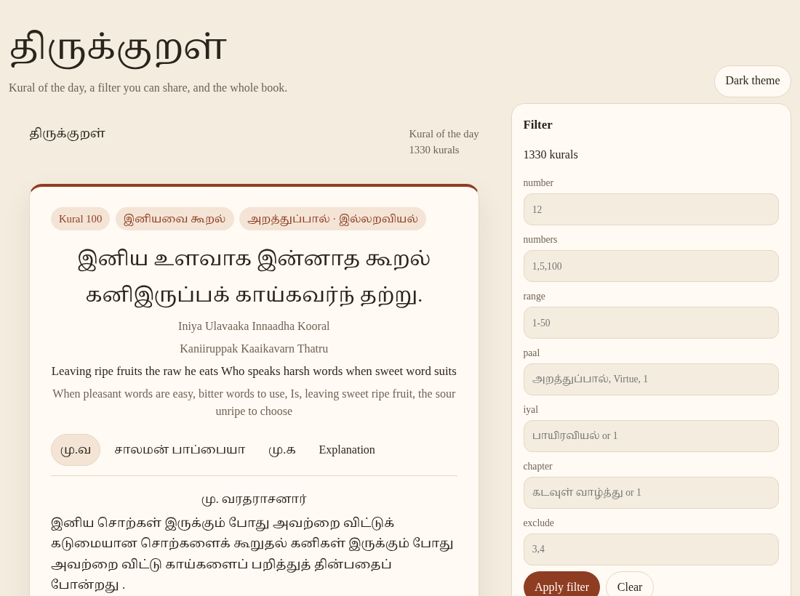

# daily-kural-js

A zero-dependency Thirukkural library for the browser, Node.js, and the command line.

உலாவி, Node, மற்றும் கட்டளை வரியில் திருக்குறளைக் காட்டும் நூலகம்.

[](https://www.npmjs.com/package/daily-kural-js)
[](https://www.npmjs.com/package/daily-kural-js)
[](https://bundlephobia.com/package/daily-kural-js)
[](https://github.com/haraldboos/daily-kural-js/actions/workflows/ci.yml)
[](./LICENSE)
[](https://www.jsdelivr.com/package/npm/daily-kural-js)



Live demo and manual: [https://haraldboos.github.io/daily-kural-js/](https://haraldboos.github.io/daily-kural-js/)

## Why use it

- All **1,330** kurals, with Tamil text, transliteration, English translation, and three commentaries.
- One filter works in the custom element, the JavaScript API, the CLI, and the page URL.
- The kural of the day is deterministic. Same date, same filter, same timezone, same kural. No server and no account.
- Drop `<daily-kural>` into any HTML page. It also runs in Node 18+ and as the `daily-kural` command.
- A bundled build inlines the data, so a page can work with no runtime fetch.

## Quick start

### Plain HTML

Save this as a file and open it through any static host. The script creates `window.DailyKural` and the `<daily-kural>` element.

```html
<!DOCTYPE html>
<html lang="en">
<head>
  <meta charset="utf-8">
  <meta name="viewport" content="width=device-width, initial-scale=1">
  <title>Today's Thirukkural</title>
</head>
<body>
  <daily-kural mode="daily" lang="both" load-fonts="google"></daily-kural>
  <script
    src="https://cdn.jsdelivr.net/npm/daily-kural-js@0.1.0/dist/daily-kural.min.js"
    integrity="sha384-TDofA9os2y9uduCSZg/dj5mF1ForeFUgmhrnKZbKsqlKpHgMltdoqRk7UxnEOdMr"
    crossorigin="anonymous"></script>
</body>
</html>
```

`@0.1.0` is this release. The `integrity` hash belongs to this file only. It changes every release. See [CDN](#cdn) and [RELEASING.md](RELEASING.md).

### npm

```bash
npm install daily-kural-js
```

```js
import { DailyKural } from 'daily-kural-js';

await DailyKural.init();
const kural = DailyKural.getDaily({
  filter: { paal: 'அறத்துப்பால்' },
  timezone: 'Asia/Kolkata',
});
console.log(kural.Number);
console.log(kural.Line1);
console.log(kural.Line2);
```

### Node and the CLI

```bash
npx daily-kural-js daily
```

After install, the command name is `daily-kural`:

```bash
daily-kural daily --paal 1 --timezone Asia/Kolkata
daily-kural number 1 --lang ta
```

## Recipes

| I want | Custom element | JavaScript | CLI |
| --- | --- | --- | --- |
| Kural of the day | `<daily-kural mode="daily">` | `DailyKural.getDaily()` | `daily-kural daily` |
| A random kural | `<daily-kural mode="random">` | `DailyKural.getRandom()` | `daily-kural random` |
| Kural 1330 | `<daily-kural mode="number" number="1330">` | `DailyKural.getByNumber(1330)` | `daily-kural number 1330` |
| A random kural from one chapter | `<daily-kural mode="random" chapter="கடவுள் வாழ்த்து">` | `DailyKural.getRandom({ filter: { chapter: 'கடவுள் வாழ்த்து' } })` | `daily-kural random --chapter "கடவுள் வாழ்த்து"` |
| Today's kural inside அறத்துப்பால் | `<daily-kural mode="daily" paal="1">` | `DailyKural.getDaily({ filter: { paal: 1 } })` | `daily-kural daily --paal 1` |
| Kurals 1 to 50 | `<daily-kural range="1-50" mode="browse">` | `DailyKural.getRange(1, 50)` | `daily-kural list --range 1-50 --limit 5` |
| Search | Use the API or CLI | `DailyKural.search('அகர')` | `daily-kural search அகர` |

Call `await DailyKural.init()` once before any JavaScript reading method.

## Filters

These keys are shared by `getDaily`, `getRandom`, `search`, `list`, the element, the CLI, and the URL.

| Key | Type | Example | Note |
| --- | --- | --- | --- |
| `number` | integer 1–1330 | `number: 12` | One kural. Still has to pass the other keys. |
| `numbers` | array of integers | `numbers: [1, 5, 100]` | Several kurals. Combined with AND. |
| `range` | `[start, end]` | `range: [1, 50]` | Inclusive. `1-50` in a string. |
| `paal` | number, string, or list | `paal: 1` or `paal: 'Virtue'` | பால். Tamil name, English, transliteration, or 1–3. A list means OR. |
| `iyal` | number, string, or list | `iyal: 'பாயிரவியல்'` | இயல். Same matching rules as paal. |
| `chapter` | number, string, or list | `chapter: 'கடவுள் வாழ்த்து'` | அதிகாரம். Same matching rules. |
| `exclude` | array of integers | `exclude: [1, 2]` | Removed after the other keys match. |

Keys combine with AND. An array on `paal`, `iyal`, or `chapter` is OR inside that key. An empty object means all 1,330 kurals. A combination that matches nothing throws `EMPTY_FILTER`.

```js
DailyKural.stringifyFilter({ paal: 1, range: [1, 50], exclude: [3, 4] });
// 'range=1-50&paal=1&exclude=3,4'

DailyKural.parseFilterString('paal=1&range=1-50&exclude=3,4');
```

String form for the element, the CLI, and links:

```text
paal=1&chapter=5&range=1-50&number=12&numbers=1,5,100&exclude=3,4
```

## `<daily-kural>`

```html
<daily-kural
  mode="daily"
  filter="paal=1&range=1-50"
  lang="both"
  commentary="all"
  theme="auto"
  timezone="Asia/Kolkata"
  show-transliteration
  show-translation
  show-meta
  load-fonts="google"
></daily-kural>
```

| Attribute | Values | Default |
| --- | --- | --- |
| `mode` | `daily`, `random`, `number`, `browse` | `daily` |
| `filter` | query string | empty, all kurals |
| `number`, `paal`, `iyal`, `chapter`, `range`, `numbers`, `exclude` | shortcuts merged into `filter` | unset |
| `lang` | `ta`, `en`, `both` | `both` |
| `commentary` | `mv`, `sp`, `mk`, `all`, `none` | `all` |
| `theme` | `light`, `dark`, `auto` | `auto` |
| `show-transliteration` | boolean attribute. `="false"` turns it off | off |
| `show-translation` | boolean attribute | on |
| `show-meta` | chapter and paal badges | on |
| `auto-refresh` | milliseconds | off |
| `sync-url` | read and write `?paal=1` and `#kural-1330` | off |
| `load-fonts` | `google`, `self`, `none` | `google` |
| `font-base` | directory of `fonts.css` when `load-fonts="self"` | guessed from the script URL |
| `timezone` | IANA name, for daily mode | the browser's zone |

Set an object filter in script. It replaces the `filter` attribute:

```js
const card = document.querySelector('daily-kural');
card.filter = { paal: 1, exclude: [1] };
card.showKural(1330);
```

`showKural(n)` shows that kural without adding `number` to the filter, so previous and next still walk the filtered set.

You can also start from a normal element. The script upgrades it:

```html
<div data-daily-kural data-mode="daily" data-filter="paal=1"></div>
```

### Events

Events bubble out of the shadow root.

| Event | `detail` |
| --- | --- |
| `kural-change` | `{ kural, filter }` |
| `kural-ready` | same shape, once, when the first kural is shown |
| `kural-error` | `{ error, code, message }` |

```js
document.querySelector('daily-kural').addEventListener('kural-ready', (event) => {
  console.log(event.detail.kural.Number);
});
```

### CSS variables

Set these on `<daily-kural>` or on an ancestor. Defaults live in `*-default` variables, so your value wins.

| Variable | Role | Default idea |
| --- | --- | --- |
| `--dk-font-tamil` | Tamil stack | Noto Serif Tamil, then Noto Sans Tamil |
| `--dk-font-latin` | English and UI | Palatino, Georgia |
| `--dk-font-size` | Tamil verse size | `clamp(1.35rem, 2.5vw, 1.75rem)` |
| `--dk-font-size-latin` | UI size | `1rem` |
| `--dk-line-height` | Tamil line-height | `1.7` |
| `--dk-line-height-latin` | UI line-height | `1.55` |
| `--dk-accent` | buttons and the card rule | terracotta `#8f3d22` |
| `--dk-accent-soft` | badges and the active tab | `#f3e4d6` |
| `--dk-bg` | page background | `#f6f1e7` |
| `--dk-fg` | text | `#2b241c` |
| `--dk-muted` | secondary text | `#6e6256` |
| `--dk-card` | card background | `#fffaf3` |
| `--dk-border` | hairline | `#e4d7c6` |
| `--dk-chip` | filter chips | `#f0e4d4` |
| `--dk-danger` | errors | `#9b2c2c` |
| `--dk-radius` | card radius | `18px` |
| `--dk-shadow` | card shadow | soft brown |
| `--dk-space` | inner padding | `1rem` |

Parts you can restyle from the outside: `kural`, `line`, `translation`, `number`, `chapter`.

```css
daily-kural {
  --dk-accent: #1f4d3a;
  --dk-font-tamil: "Noto Sans Tamil", sans-serif;
}
daily-kural::part(line) {
  font-size: 1.6rem;
}
```

## CLI

| Command | What it prints |
| --- | --- |
| `daily-kural daily` | The kural for this civil date |
| `daily-kural random` | A random kural. Skips the last few shown in this process |
| `daily-kural number <1-1330>` | That kural |
| `daily-kural search <text>` | Matches. Default limit is 20 |
| `daily-kural list` | Kurals in the filter. Add `--limit` |
| `daily-kural count` | How many kurals match |
| `daily-kural help` | The help text |

| Flag | Meaning |
| --- | --- |
| `--paal`, `--iyal`, `--chapter` | Category. Commas mean OR |
| `--range 1-100` | Inclusive range |
| `--number`, `--numbers`, `--exclude` | Same as the filter object |
| `--filter` | A full query string. The flags above override it |
| `--lang ta\|en\|both` | Default `both` |
| `--commentary mv\|sp\|mk\|all\|none` | Default `none` |
| `--json` | Print JSON |
| `--date YYYY-MM-DD` | Daily only |
| `--timezone <IANA>` | Daily only |
| `--limit`, `--offset` | List and search |
| `--fields` | Comma-separated search fields |
| `--avoid <n>` | Random: skip the last n picks in this process |

## Use it in a site

### React

```jsx
import { useEffect, useState } from 'react';
import { DailyKural } from 'daily-kural-js';

export function KuralOfTheDay() {
  const [kural, setKural] = useState(null);
  useEffect(() => {
    let live = true;
    DailyKural.init().then(() => {
      if (live) setKural(DailyKural.getDaily({ timezone: 'Asia/Kolkata' }));
    });
    return () => {
      live = false;
    };
  }, []);
  if (!kural) return <p>Loading…</p>;
  return (
    <article lang="ta">
      <p>{kural.Line1}</p>
      <p>{kural.Line2}</p>
      <p lang="en">{kural.Translation}</p>
    </article>
  );
}
```

Or use the element. Import the side-effect entry once so the tag is registered:

```jsx
import 'daily-kural-js/element';

export function KuralCard() {
  return <daily-kural mode="daily" lang="both" timezone="Asia/Kolkata"></daily-kural>;
}
```

### Vue

```vue
<script setup>
import 'daily-kural-js/element';
</script>

<template>
  <daily-kural mode="daily" lang="both" timezone="Asia/Kolkata"></daily-kural>
</template>
```

### Svelte

```svelte
<script>
  import 'daily-kural-js/element';
</script>

<daily-kural mode="daily" lang="both" timezone="Asia/Kolkata"></daily-kural>
```

### Next.js

Use a client component. The element needs the browser.

```jsx
'use client';

import 'daily-kural-js/element';

export default function Page() {
  return <daily-kural mode="daily" lang="both" timezone="Asia/Kolkata"></daily-kural>;
}
```

### WordPress

Add a Custom HTML block:

```html
<script
  src="https://cdn.jsdelivr.net/npm/daily-kural-js@0.1.0/dist/daily-kural.min.js"
  integrity="sha384-TDofA9os2y9uduCSZg/dj5mF1ForeFUgmhrnKZbKsqlKpHgMltdoqRk7UxnEOdMr"
  crossorigin="anonymous"></script>
<daily-kural mode="daily" lang="both" load-fonts="google"></daily-kural>
```

If the script disappears after you save, the site is stripping script tags. Enqueue the script from a small plugin, or allow unfiltered HTML for an editor you trust.

### Blogger and other static sites

Use the same HTML as the [quick start](#plain-html). In Blogger, add an HTML gadget. A full example that only uses CDN URLs is in [examples/cdn.html](examples/cdn.html).

## Fonts

Tamil needs a font that contains the Tamil block. Otherwise the letters become boxes.

`load-fonts` has three modes:

| Mode | What happens |
| --- | --- |
| `google` | Adds Noto Serif Tamil and Noto Sans Tamil from Google Fonts. This is the default. |
| `self` | Loads `fonts.css` from `font-base`, or from `../fonts/` next to the script. The npm package includes that CSS and the font files. |
| `none` | Loads nothing. Use your own `@font-face` or a font already on the page. |

Self-hosted CSS, from the package or from jsDelivr:

```html
<link
  rel="stylesheet"
  href="https://cdn.jsdelivr.net/npm/daily-kural-js@0.1.0/fonts/fonts.css"
  integrity="sha384-1b+0RBcX7Cr8rSeKT1RxNWjUC2Q2tou4KL/HK4Jm2U3FNm35WD9rdM+FCZOtw76Y"
  crossorigin="anonymous">
<daily-kural mode="daily" load-fonts="none"></daily-kural>
```

Your own font:

```css
daily-kural {
  --dk-font-tamil: "My Tamil Face", "Noto Sans Tamil", sans-serif;
}
```

```html
<daily-kural mode="daily" load-fonts="none"></daily-kural>
```

From JavaScript, `DailyKural.loadFonts('google' | 'self' | 'none')` does the same injection into `document.head`. `@font-face` inside the shadow root would not apply, so the faces are added to the document.

Noto Serif Tamil and Noto Sans Tamil are copyright Google and the Noto project authors. They are SIL OFL 1.1. See [NOTICE](NOTICE) and [fonts/OFL.txt](fonts/OFL.txt).

## CDN

jsDelivr and unpkg serve this package automatically after it is on npm. There is no separate upload.

Pin a version in production. `@1` tracks the latest 1.x. `@latest` can change under you and break an `integrity` hash. Do not use `@latest` on a public site.

| File | URL |
| --- | --- |
| Script (recommended) | `https://cdn.jsdelivr.net/npm/daily-kural-js@0.1.0/dist/daily-kural.min.js` |
| unpkg | `https://unpkg.com/daily-kural-js@0.1.0/dist/daily-kural.min.js` |
| ESM | `https://cdn.jsdelivr.net/npm/daily-kural-js@0.1.0/+esm` |
| Fonts | `https://cdn.jsdelivr.net/npm/daily-kural-js@0.1.0/fonts/fonts.css` |
| Offline bundle | `https://cdn.jsdelivr.net/npm/daily-kural-js@0.1.0/dist/daily-kural.bundled.min.js` |

These URLs answer after the first publish. Until then they 404.

Copy-paste tags for **0.1.0**. Regenerate them with `npm run sri` on every release.

```html
<script
  src="https://cdn.jsdelivr.net/npm/daily-kural-js@0.1.0/dist/daily-kural.min.js"
  integrity="sha384-TDofA9os2y9uduCSZg/dj5mF1ForeFUgmhrnKZbKsqlKpHgMltdoqRk7UxnEOdMr"
  crossorigin="anonymous"></script>
```

```html
<script
  src="https://cdn.jsdelivr.net/npm/daily-kural-js@0.1.0/dist/daily-kural.bundled.min.js"
  integrity="sha384-3gvwRBt2FOCaC92hJ6P86xvZ70+QwbQ6AgYu+Od+eRMOoawyiuvLdcsfzVEWVe8V"
  crossorigin="anonymous"></script>
```

```html
<link
  rel="stylesheet"
  href="https://cdn.jsdelivr.net/npm/daily-kural-js@0.1.0/fonts/fonts.css"
  integrity="sha384-1b+0RBcX7Cr8rSeKT1RxNWjUC2Q2tou4KL/HK4Jm2U3FNm35WD9rdM+FCZOtw76Y"
  crossorigin="anonymous">
```

The small script fetches the verses at runtime. Raw GitHub and the jsDelivr mirror of the data repo both send `Access-Control-Allow-Origin: *`, so a page on another origin can read them. The data URLs are pinned to commit `cf3ff6c5a73c23b4092913156830457caab65fd4` of [tk120404/thirukkural](https://github.com/tk120404/thirukkural). If you do not want that fetch, use `dist/daily-kural.bundled.min.js`. It has the JSON inside it. It is about 3.7 MB raw and about 591 kB gzip.

If a just-published file is stale on jsDelivr, purge that exact URL:

```text
https://purge.jsdelivr.net/npm/daily-kural-js@0.1.0/dist/daily-kural.min.js
```

Open it in a browser, or `curl` it. Purge one file at a time.

## Browser and Node support

- Browsers with custom elements and `fetch`: current Chrome, Firefox, Safari, and Edge.
- Node.js 18 or newer. `require` and `import` both work.
- No runtime dependencies.

| Build | Raw | Gzip | Use it when |
| --- | --- | --- | --- |
| `dist/daily-kural.min.js` | 53.3 kB | 16.3 kB | A page can fetch the data |
| `dist/daily-kural.bundled.min.js` | 3670.8 kB | 591.1 kB | You want the data inside the script |
| `dist/index.mjs` | 85.2 kB | 20.8 kB | Node or a bundler, ESM |
| `dist/index.cjs` | 87.1 kB | 21.5 kB | `require` |

`npm run size` prints this table from the files on disk.

## More documentation

- [User manual](USER_MANUAL.md) for people who have not used npm. The same guide is at [docs/manual.md](docs/manual.md) and on the [Pages site](https://haraldboos.github.io/daily-kural-js/manual.html).
- [API reference](docs/api.md)
- [Changelog](CHANGELOG.md)
- [Releasing](RELEASING.md)
- [Contributing](CONTRIBUTING.md)

## Enable GitHub Pages

The site is built by [.github/workflows/pages.yml](.github/workflows/pages.yml). It publishes the demo, the manual, and the API reference.

1. Push this repository to GitHub. The default branch should be `main`.
2. Open **Settings → Pages**.
3. Under **Build and deployment**, set **Source** to **GitHub Actions**.
4. Push to `main`, or run the **Pages** workflow from the Actions tab.
5. The site URL is `https://<github-username>.github.io/daily-kural-js/`.

The GitHub repository is [haraldboos/daily-kural-js](https://github.com/haraldboos/daily-kural-js).

## Contributing

Issues and pull requests are welcome. See [CONTRIBUTING.md](CONTRIBUTING.md). Please read the [code of conduct](CODE_OF_CONDUCT.md). To report a security problem, see [SECURITY.md](SECURITY.md).

```bash
npm install
npm test
npm run lint
npm run build
```

## Licence and attribution

The code is [MIT](LICENSE), copyright 2026 Abilash.

The verses, translations, commentaries, and the section structure come from [tk120404/thirukkural](https://github.com/tk120404/thirukkural) (Apache-2.0), pinned at `cf3ff6c5a73c23b4092913156830457caab65fd4`. Commentaries included there:

- மு. வரதராசனார் (`mv`)
- சாலமன் பாப்பையா (`sp`)
- மு. கருணாநிதி (`mk`)

The bundled fonts are Noto Serif Tamil and Noto Sans Tamil, SIL OFL 1.1. Details are in [NOTICE](NOTICE).
